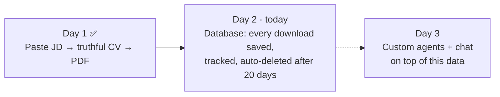
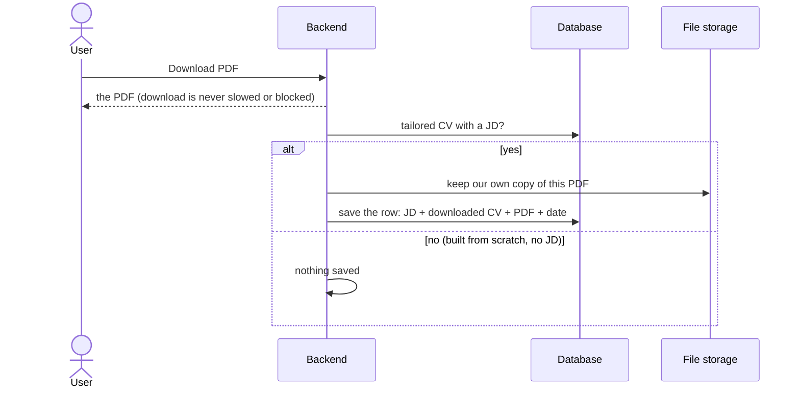
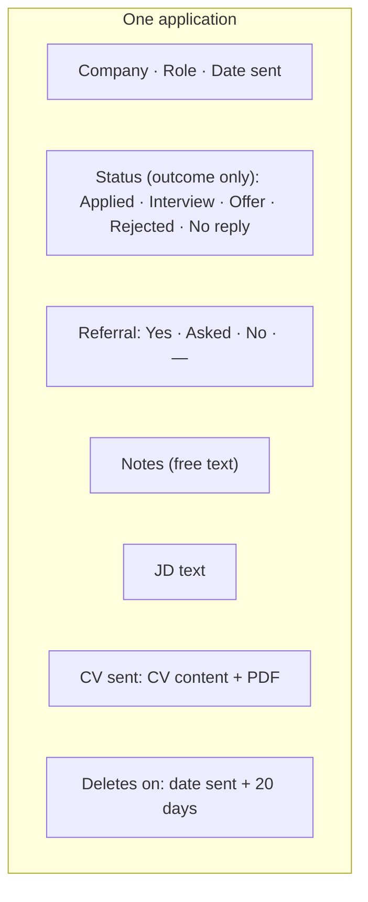
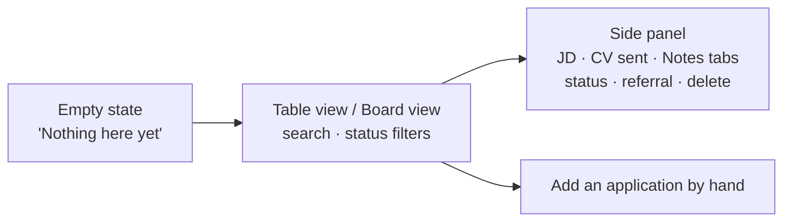
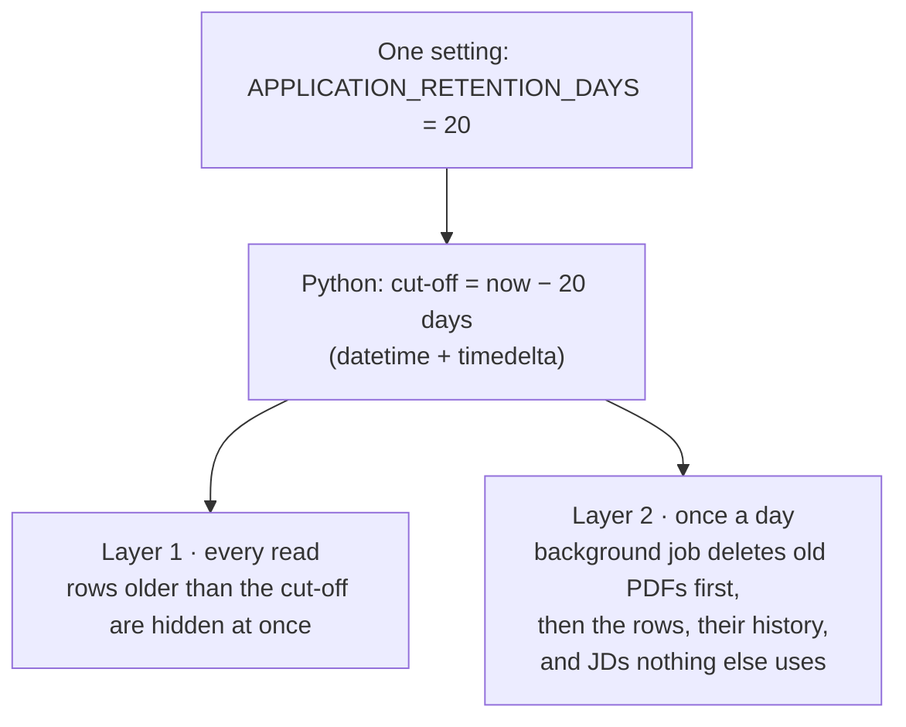

# Day 2: The Database (backend + UI wiring)

**Honne Careers in one line:** an AI career copilot that creates job-tailored CVs, analyzes applications, learns from previous attempts, and eventually lets users build custom career agents.

**What this file is:** context for planning, in plain English: *what* we build today and *why*. The LLD is written during planning in Claude Code.
Read with [CLAUDE.md](./CLAUDE.md), [project_requirements.md](./project_requirements.md) (§0 product goal), [guardrails.md](./guardrails.md) and [Day_1.md](./Day_1.md).

---

## 0. Where we are

The copilot can only analyze applications and learn from previous attempts if every application is recorded in one place. Today builds that place: the backend for the *Database* screens and the wiring between the existing UI and it. Everything saved today must stay clean and readable, because agents (ours and the user's) will work on top of it from Day 3 (requirements §0).

No AI is used in today's work.

---

## 1. The rule

**When the user clicks Download PDF for a JD, that CV is the CV used for that JD.** Nothing after that is tracked: later edits or a different file used when applying are not our concern. At download we save the **JD, the downloaded CV and its PDF** as one row in the user's Database.

- **One JD = one row.** Downloading again for the same JD replaces that row's CV and PDF, so the latest download is the one we keep. Status, referral and notes stay.
- **Our own PDF copy** stays with the row even if the user deletes the resume card. The copy is made inside storage, so no file passes through the backend.
- **The CV content is saved too, not only the PDF**, because the analysis and the agents read the CV field by field.

## 2. One row

- "Referral asked" is removed from Status, so each fact lives in one place.
- Each status change is also logged (from → to, when). This is what lets the copilot learn later, e.g. "rejections came within 3 days".
- Users can add applications made outside Honne by hand, with or without a JD.

## 3. The screens already exist: wire them

The *Database* screens are designed on the canvas *Honne Careers Landing Page*, row "Feature 2":

Today's job is the backend behind these screens and wiring the frontend to it: list, open, change status/referral/notes, add by hand, delete. Two tabs editing one row must not silently overwrite each other.

**Copy changes:** "We keep your 20 most recent" becomes **"Saved for 20 days"**, with a **"Deletes on"** date per row; the number comes from the backend. Status loses "Referral asked", and the Referral column shows Yes / Asked / No / —.

## 4. Auto-delete after 20 days

- **Easy to change:** the number lives only in that setting, read through the existing plan check, so paid plans can get more days later. Rows store only their creation date, so a new number applies to every row that still exists, with no database change.
- **Low load:** reads gain one date filter, and the clean-up runs once a day in batches.
- **Files before rows:** if a file can't be deleted, its row stays hidden and is retried the next day. No orphan files.
- **Render free plan sleeps** after 15 min idle, so the daily clean-up runs when it wakes. Users never see old rows meanwhile.
- **Only the clean-up job touches every user's rows**, and all it can do is delete rows past the cut-off. Normal requests can't call it.

## 5. Safety

- Each user only sees their own rows and PDFs, with the same database isolation as every Day 1 table.
- Logs carry ids, counts and outcomes, never JD, CV or notes text.
- Deleting the account removes the Database rows and their PDFs.
- Every failure is visible: if saving a row fails, the download still works and the user is told "We couldn't save it to your Database, try again".

## 6. Done when

1. A download for a JD saves one row (JD + CV + PDF); downloading again for that JD replaces the CV and PDF and keeps status, referral and notes.
2. The Database screens show real data: list, filter, search, open, update, add by hand, delete.
3. Rows older than the setting are hidden at once and deleted by the daily job; changing the number needs no migration.
4. Isolation tests cover every new table and the stored PDFs; no CV, JD or notes text in logs.

## 7. Open questions for Akash

| # | Question | Suggestion |
| :---- | :---- | :---- |
| 1 | CVs built from scratch (no JD): save a row on download? | No, there's no job to attach it to |
| 2 | Optional "company type" column (ESN, startup, big tech…), as in your own job-search sheet? | Yes, the analysis will need it |
